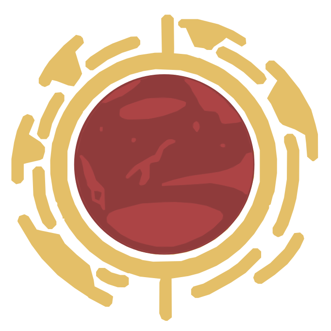
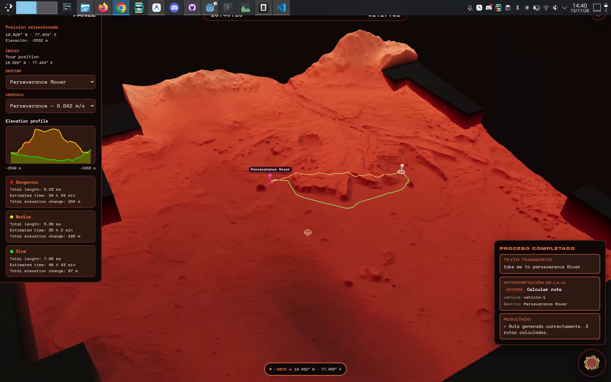
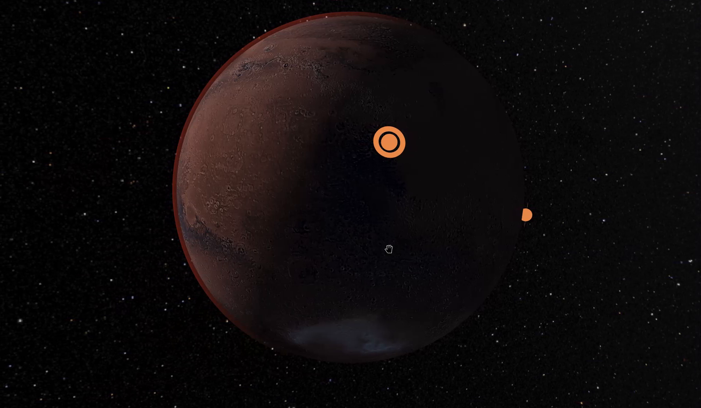
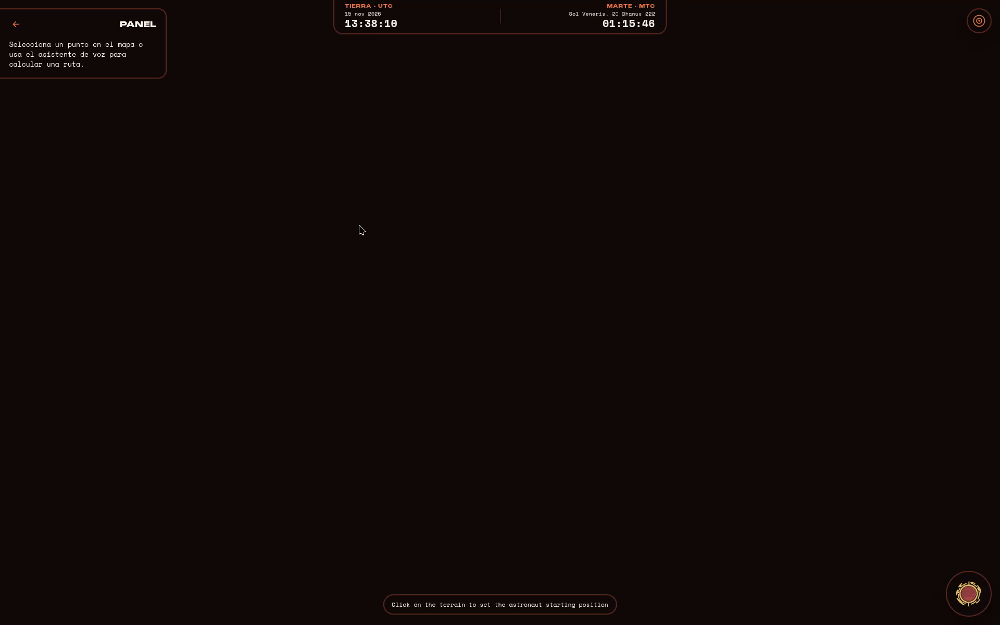
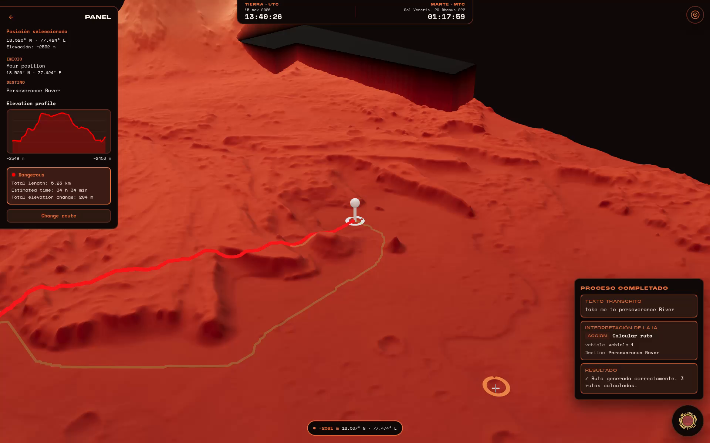

<div align="center">



# Maia

**An offline navigation assistant for Mars.**

Voice-first. Local models. Three risk-rated routes computed from a real digital elevation model.

[](https://fastapi.tiangolo.com/)
[](https://react.dev/)
[](https://threejs.org/)
[](https://ollama.com/)
[](https://docs.docker.com/compose/)

</div>



---

## Contents

- [Demo](#demo)
- [What it does](#what-it-does)
- [How it works](#how-it-works)
- [Why we built it this way](#why-we-built-it-this-way)
- [Intended impact](#intended-impact)
- [What makes it different](#what-makes-it-different)
- [What we considered](#what-we-considered)
- [Tech stack](#tech-stack)
- [Project structure](#project-structure)
- [Getting started](#getting-started)
- [Using Maia](#using-maia)
- [API](#api)
- [Data pipeline](#data-pipeline)
- [How routes are scored](#how-routes-are-scored)
- [Future work](#future-work)
- [Troubleshooting](#troubleshooting)

---

## Demo

### The whole system, with the network disconnected

The first demo opens the global Mars view and proves that the app is running without an internet connection: while Maia is fully usable, the browser is showing its offline dinosaur game. Map rendering, terrain, the interface and the local services all keep working.

[](docs/media/global-demo.mp4)

<video src="docs/media/global-demo.mp4" poster="docs/media/screenshot-global.png" controls muted playsinline>
  Your browser does not support embedded video. <a href="docs/media/global-demo.mp4">Download the offline demo</a>.
</video>

*`docs/media/global-demo.mp4` — global view, no network.*



*The offline proof: `DNS_PROBE_FINISHED_NO_INTERNET` in the browser while the local stack is still serving the map.*

### Voice command, route calculation and route selection

The second demo goes to a terrain view, asks Maia to go to **Perseverance**, and shows the three computed routes. The user then selects one of them from the left panel and Maia zooms the camera to the chosen route.

[](docs/media/route-demo.mp4)

<video src="docs/media/route-demo.mp4" poster="docs/media/screenshot-routes.png" controls muted playsinline>
  Your browser does not support embedded video. <a href="docs/media/route-demo.mp4">Download the routing demo</a>.
</video>

*`docs/media/route-demo.mp4` — “take me to Perseverance”, three routes, route selection.*

---

## What it does

**Maia is a navigation assistant for Mars that works with no internet connection.** We run it as a local server with Docker Compose, and it uses Ollama to host the decision model on the device itself. You talk to Maia instead of typing, using the Web Speech API, and she runs the commands for you. That matters because typing in a pressurized glove is a pain.

Ask her for a route and you get **three options, coloured like a traffic light by risk**:

| Colour | Risk | What it means |
| :---: | :--- | :--- |
| 🔴 Red | **Dangerous** | Shortest and most direct route. It may cross steep slopes. |
| 🟡 Yellow | **Medium** | A compromise between distance and terrain difficulty. |
| 🟢 Green | **Slow** | The safest route. It avoids slopes even if it has to travel farther. |

Travel time for each route is calculated from a starting point on a **real digital elevation model (DEM)**, using the speed and climbing capabilities of rovers that already exist: Sojourner, Spirit, Opportunity, Curiosity and Perseverance. Every route also shows its total length, estimated travel time, total elevation change and an elevation profile.

The interface has two main views:

- **Global view** (`/global`) — an interactive 3D Mars globe with the three available exploration zones and the Earth/Mars clock in the header.
- **Terrain view** (`/partial/:poiId`) — a 3D terrain model of Jezero Crater, Gale Crater or Valles Marineris. You click the terrain to place the astronaut, speak or choose a destination, and inspect the routes.

Astronauts can also **add their own points to the map**. In the demo that only saves a location, but it is the part we are most curious to grow: the map can improve as the crew explores, without waiting for an update from Earth.

Maia can answer one more question that is very human: **“How far is Earth?”** The backend computes the current Earth–Mars distance from the astronaut's position on Mars to Lantejuela, Seville (Spain), using low-precision orbital elements.

---

## How it works

```text
┌──────────────────────────── Browser (React + Three.js) ────────────────────────────┐
│                                                                                   │
│  microphone ──► Web Speech API ──► transcript ──► POST /ai                        │
│                     (on-device when offline)          │                            │
│                                                       ▼                            │
│  3D globe / 3D terrain  ◄── routes ◄── POST /path ◄── FastAPI backend              │
│  elevation profile,                                            │                  │
│  travel time, risk colours                                     ▼                  │
│                                                         Ollama + local model       │
│                                                         (inside Docker Compose)    │
└───────────────────────────────────────────────────────────────────────────────────┘
```

1. **Speech to text.** The browser captures the voice command with the Web Speech API. When the browser is offline, recognition runs on-device with the browser's local `en-US` model. When the browser is online, it may use its faster cloud recognizer and downloads the local model in the background, so Maia is ready when the connection drops. The user does not need to type.
2. **Instruction understanding.** The transcript goes to `POST /ai`. The local decision model works in two steps: first it classifies the action (`navigate_to`, `add_location`, `distance_to_earth`, or none), then it extracts the action parameters (for example the destination and the vehicle). Destinations are restricted to the locations stored for the current zone, which keeps the model grounded and avoids invented coordinates.
3. **Route calculation.** `POST /path` loads a preprocessed `.npz` DEM, crops a search window around the start and end points, downsamples it, builds an 8-connected graph and runs A* three times. Each run uses a different slope penalty. The result is three paths that trade distance for terrain smoothness.
4. **Rendering and timing.** The frontend maps DEM pixels back onto the 3D terrain, draws each route as a coloured tube and computes its 3D length. Travel time is `length / rover speed`, with the rover's maximum climbable slope used to block edges that are too steep.
5. **Crew-added points.** `POST /location` looks up the elevation of a coordinate in the zone DEM and appends the point to `data/locations.csv`. Those points immediately become valid destinations for future voice commands.

Everything in the route and assistant path is local. There is no cloud LLM and no remote map service at runtime.

---

## Why we built it this way

Mars does not have an instant connection to Earth. A tool that needs the internet is a tool that fails at the worst possible moment. We wanted something that keeps working when communications are down, and that could help an astronaut get back to base.

That constraint drove the architecture:

- **Local first.** The DEMs, terrain assets, route engine, model and point store all live on the machine running Maia.
- **Voice first.** Astronauts wear pressurized gloves. Speaking a destination is more realistic than tapping a map.
- **Risk you can read at a glance.** A traffic-light colour scheme works under stress and through a visor. You do not need to read a table to know which route is the safe one.
- **Small hardware as a target.** Because the heavy work is local and the models can be small, the same design can eventually run on a wearable or a vehicle computer instead of a full laptop.

---

## Intended impact

We want astronauts to have one less thing to worry about when something goes wrong. If the link to Earth is down, or the astronaut is tired, or visibility is poor, Maia should still be able to answer: *where am I, how do I get back, and which way is safest?*

The crew-added map points are the other half of the idea. A map that only changes when Earth sends an update is a map that is always behind reality. A map that the crew can extend in the field becomes more useful the longer the mission runs.

---

## What makes it different

Most navigation tools assume you are online. We started from the opposite assumption and built around it:

- a local assistant with no cloud dependency;
- voice control designed for gloved hands;
- a risk system you can read at a glance, not a wall of numbers;
- real rover capabilities instead of a generic walking speed;
- a terrain model built from actual Mars elevation data, not a flat map with drawn lines.

---

## What we considered

- **No connectivity.** Every runtime dependency had to be local: models, elevation data, terrain tiles and route computation.
- **Hands that cannot type.** Voice is the primary input; map clicks, selectors and the API are the fallbacks.
- **The cost of picking a risky route.** A shorter path is not automatically the better path. The three-route design makes the trade-off explicit.
- **Hardware that may be very small.** The models and the search grid can be reduced; the architecture does not assume a data centre.
- **Crew data kept simple on purpose.** A map point is just a name, coordinates, elevation and zone. That is enough to prove the workflow, and simple enough to extend later.

---

## Tech stack

| Layer | Technology | Why |
| :--- | :--- | :--- |
| Frontend | React 19, TypeScript, Vite | Fast local development and a typed UI. |
| 3D | Three.js | Interactive Mars globe and 3D terrain with route tubes. |
| Routing UI | React Router | `/global` and `/partial/:poiId` views. |
| Voice | Web Speech API, `en-US` local model | Talk instead of typing; local recognition when offline. |
| Backend | Python 3.12, FastAPI, Uvicorn | Small, typed HTTP API with automatic OpenAPI docs. |
| Geospatial | NumPy, Rasterio, NetworkX | DEM loading, coordinate transforms and A* over a terrain graph. |
| AI | Ollama + local decision model | On-device instruction understanding. |
| Data | GeoTIFF DEMs + preprocessed `.npz` | Real Mars elevation, fast repeated searches. |
| Infrastructure | Docker Compose | One command to run the frontend, backend, Ollama and model pull. |
| Tests | pytest | Smoke tests for the pathfinding engine. |

The default compose file pulls `d1-omni:latest` as the decision model and exposes Ollama on port `11434`. The model is configurable; see [Getting started](#getting-started).

---

## Project structure

```text
martian-map/
├── backend/
│   ├── main.py                  # FastAPI app, CORS and routers
│   ├── config.py                # Paths, model and action definitions
│   ├── libs/
│   │   ├── ai.py                # Action selection and parameter extraction
│   │   └── pathfinding.py       # DEM loading, A* and three-route search
│   ├── routes/
│   │   ├── ai.py                # POST /ai
│   │   ├── path.py              # POST /path
│   │   ├── locations.py         # GET/POST /locations, POST /location
│   │   └── distance_lantejuela.py  # POST /distance-to-lantejuela
│   ├── tests/test_pathfinding.py
│   ├── Dockerfile
│   └── entrypoint.sh            # Downloads map data on first boot
├── frontend/
│   ├── src/
│   │   ├── components/          # GlobalMap, TerrainViewer, SidePanel, AIOverlay
│   │   ├── routes/              # Global.tsx, Partial.tsx
│   │   ├── hooks/               # useSpeechToText.ts
│   │   ├── utils/               # terrain, path, rover and Mars-time helpers
│   │   └── data/                # POIs and rover definitions
│   └── public/
│       ├── rovers/              # Rover photos
│       ├── skyblock/            # Space skybox
│       └── terrain/             # Heightmaps and rockiness layers per zone
├── scripts/
│   ├── download-map.py          # Downloads DEMs from the data releases
│   ├── preprocess_dem_backend.py# GeoTIFF -> .npz for the route engine
│   ├── process-dem.py           # DEM -> web heightmap for Three.js
│   └── process-rocky.py         # THEMIS rockiness -> aligned layers
├── data/                        # DEM sources, .npz files and locations.csv
├── docs/media/                  # Demo videos and screenshots
└── docker-compose.yml
```

The large DEM files under `data/` are intentionally git-ignored. They are downloaded automatically on first boot, or manually with the script described below.

---

## Getting started

### Prerequisites

- Docker Engine with Docker Compose v2.
- About **4–5 GB of free disk space** for the map data, the Ollama image, the decision model and the browser speech model.
- A microphone and a Chromium-based browser (Chrome or Edge) with Web Speech API support. Firefox and Safari do not provide the same local speech-recognition API.
- **Internet for the first setup only.** The first run pulls the Ollama model and downloads the map data. After that, Maia can run with the network disconnected.

> **Important:** “offline” means offline at runtime, not offline from the very first second. Pull the model, download the DEMs and install the browser's local `en-US` speech model once while connected. Then disconnect and the demo works as shown in the video.

### 1. Clone the repository

```bash
git clone git@github.com:Jenga-Poker/martian-map.git
cd martian-map
```

You can also use the HTTPS URL if you do not have SSH keys configured.

### 2. Start the stack

```bash
docker compose up --build
```

This starts four services:

| Service | Address | What it does |
| :--- | :--- | :--- |
| `frontend` | <http://localhost:5173> | Vite dev server with the React app. |
| `backend` | <http://localhost:8000> | FastAPI route, location and AI endpoints. |
| `ollama` | <http://localhost:11434> | Local model runtime. |
| `ollama-pull` | — | One-shot job that pulls the decision model, then exits. |

The backend waits for `ollama-pull` to finish. On the first boot it also downloads the DEM files and preprocessed `.npz` archives from the [martian-map-data releases](https://github.com/Jenga-Poker/martian-map-data/releases) if `data/` does not yet contain any `.npz` file. Expect a few minutes and roughly 1.8 GB of downloads.

Check that the API is up:

```bash
curl http://localhost:8000/
# {"status":"ok"}
```

Then open:

- **Global view:** <http://localhost:5173/global>
- **Jezero terrain:** <http://localhost:5173/partial/jezero>
- **Gale terrain:** <http://localhost:5173/partial/gale>
- **Valles Marineris:** <http://localhost:5173/partial/valles>
- **Interactive API docs:** <http://localhost:8000/docs>

### 3. Prepare the offline demo

1. Run the stack once with internet access.
2. Wait until the `ollama-pull` service has finished and the backend is healthy.
3. Open the app and press the Maia button once, or simply leave the page open while online. The browser downloads the local `en-US` speech model in the background.
4. Disconnect the network (or use the browser's offline mode) and reload. The globe, terrains, route engine and crew-added points still work. If the speech model is installed, voice commands work too.

To stop the stack without losing the downloaded model:

```bash
docker compose down
```

Do **not** use `docker compose down -v` unless you also want to delete the `ollama_data` volume and re-download the model on the next start.

### Use a different model

The compose file has the model name in two places:

```yaml
ollama-pull:
  entrypoint: ["ollama", "pull", "d1-omni:latest"]

backend:
  environment:
    - MODEL_OLLAMA=d1-omni:latest
```

Change both values to the Ollama-compatible model you want to use, then restart:

```bash
docker compose up -d ollama-pull backend
```

If the model is not available in your Ollama registry, `ollama-pull` will fail and the backend will not start. That is deliberate: a missing model should be a visible setup error, not a silent assistant failure.

### Use an Ollama server running on the host

If you already run Ollama outside Docker, expose it on the network and point the backend at it.

On Linux, edit the service:

```bash
sudo systemctl edit ollama.service
```

Add:

```ini
[Service]
Environment="OLLAMA_HOST=0.0.0.0"
```

Then reload and restart:

```bash
sudo systemctl daemon-reload
sudo systemctl restart ollama
```

In `docker-compose.yml`, set the backend URL to the host and add the host gateway mapping:

```yaml
backend:
  environment:
    - OLLAMA_URL=http://host.docker.internal:11434
  extra_hosts:
    - "host.docker.internal:host-gateway"
```

You can then remove the `ollama` and `ollama-pull` services, along with their `depends_on` entries under `backend`. For a fully local (non-Docker) backend, create `backend/.env` with:

```dotenv
OLLAMA_URL=http://localhost:11434
MODEL_OLLAMA=d1-omni:latest
```

### Manual setup (without Docker)

Use this if you want to run the services directly on your machine.

**Backend:**

```bash
python3 -m venv .venv
source .venv/bin/activate
pip install -r backend/requirements.txt
pip install -r scripts/requirements.txt

# From the repository root: downloads the DEM sources into data/
python scripts/download-map.py

# Converts the GeoTIFFs into the .npz files used by the route engine
python scripts/preprocess_dem_backend.py

# Start the API
cd backend
DATA_DIR=../data uvicorn main:app --reload --port 8000
```

The backend also expects an Ollama-compatible server at `OLLAMA_URL` (default `http://localhost:11434`) with the model named in `MODEL_OLLAMA`. Start Ollama and pull the model before launching the API.

**Frontend:**

```bash
cd frontend
npm install
npm run dev
```

Vite serves on <http://localhost:5173>. The frontend defaults to `http://localhost:8000` for the API. Override it if needed:

```bash
VITE_API_URL=http://localhost:8000 npm run dev
```

### Configuration reference

| Variable | Service | Default | Purpose |
| :--- | :--- | :--- | :--- |
| `MODEL_OLLAMA` | backend | `d1-omni:latest` in compose | Model used for action selection and parameter extraction. |
| `OLLAMA_URL` | backend | `http://ollama:11434` in compose, `http://localhost:11434` locally | Ollama-compatible endpoint. `OLLAMA_HOST` is also accepted as a fallback. |
| `OLLAMA_API_KEY` | backend | unset | Optional bearer token if your endpoint requires one. |
| `DATA_DIR` | backend | auto-detected | Overrides the directory containing `locations.csv` and the `.npz` DEMs. |
| `VITE_API_URL` | frontend | `http://localhost:8000` | Backend base URL used by the browser. |

The backend only allows CORS from `http://localhost:5173` and `http://127.0.0.1:5173`. If you serve the frontend from another host or port, add that origin in `backend/main.py`.

---

## Using Maia

1. Open the **global view** and click one of the orange markers (Jezero, Gale or Valles Marineris). Alternatively, go directly to `/partial/jezero`, `/partial/gale` or `/partial/valles`.
2. In the terrain view, **click the surface** to place the astronaut's starting position. The panel shows the coordinates and elevation.
3. Press the **Maia button** in the bottom-right corner. Wait for “Listening locally…” and say something like:
   - *“Take me to Perseverance Rover.”*
   - *“Navigate to the Curiosity Rover.”*
   - *“How far is Earth?”*
   - *“Add a location here.”*
4. For a route, Maia shows the transcript, her interpretation (action, vehicle and destination) and the result. Three routes appear on the terrain and in the left panel, ordered **red / yellow / green**.
5. Click one of the route cards to preview it. The elevation profile and the camera update. Press **Select this route** to commit, or **Change route** to go back.
6. Use the **Vehicle** selector to compare travel times for different real rovers.
7. To add a crew point, hover over the terrain so the readout shows the coordinates, then ask Maia to add a location and enter a name in the modal. The point is stored in `data/locations.csv` and becomes a selectable destination.

The speech model is `en-US`, so speak English. The backend also accepts text instructions through the API, which is useful for testing without a microphone.

---

## API

Interactive documentation is available at <http://localhost:8000/docs>. The main endpoints are:

| Method | Endpoint | Description |
| :--- | :--- | :--- |
| `GET` | `/` | Health check. Returns `{"status":"ok"}`. |
| `POST` | `/ai` | Interprets a natural-language instruction for a zone. |
| `POST` | `/path` | Computes three routes between two coordinates on a DEM. |
| `GET` | `/locations` | Lists every stored map point. |
| `GET` | `/locations/{zone}` | Lists the points belonging to one zone. |
| `POST` | `/location` | Adds a point and derives its elevation from the zone DEM. `POST /locations` is an alias. |
| `POST` | `/distance-to-lantejuela` | Computes the Earth–Mars distance at a given time. |

<details>
<summary><strong>Example: ask for a route</strong></summary>

```bash
curl -X POST http://localhost:8000/ai \
  -H 'Content-Type: application/json' \
  -d '{"instruction":"take me to Perseverance Rover","zone":"jezero"}'
```

```json
{
  "action": "navigate_to",
  "options": {
    "vehicle": "vehicle-1",
    "end": "Perseverance Rover"
  }
}
```

</details>

<details>
<summary><strong>Example: calculate the routes</strong></summary>

```bash
curl -X POST http://localhost:8000/path \
  -H 'Content-Type: application/json' \
  -d '{
    "zone": "jezero_dem_1m",
    "start": {"lat": 18.526, "lon": 77.424},
    "end":   {"lat": 18.447, "lon": 77.402},
    "max_height_diff": 0.4,
    "multipliers": [1, 50, 500]
  }'
```

The response is a list of route objects with `height_multiplier`, `path` (DEM pixels), `heights`, `total_cost` and `total_height_variation`.

</details>

<details>
<summary><strong>Example: add a crew point</strong></summary>

```bash
curl -X POST http://localhost:8000/location \
  -H 'Content-Type: application/json' \
  -d '{"name":"Sample Site A","lat":18.45,"lon":77.44,"zone":"jezero"}'
```

The backend reads the elevation from the zone DEM and appends the point to `data/locations.csv`.

</details>

<details>
<summary><strong>Example: distance to Earth</strong></summary>

```bash
curl -X POST http://localhost:8000/distance-to-lantejuela \
  -H 'Content-Type: application/json' \
  -d '{
    "point": {"lat": 18.45, "lon": 77.44, "height_km": -2.5},
    "mars_time": "2026-11-15T12:00:00Z"
  }'
```

The endpoint uses low-precision JPL orbital elements and the rotation of both planets. It is a fun, useful approximation, not an ephemeris-grade navigation product.

</details>

---

## Data pipeline

Maia ships with three prepared exploration zones:

| Zone | Route ID | Terrain directory | Area | Source DEM |
| :--- | :--- | :--- | :--- | :--- |
| Jezero Crater | `jezero` | `crater_jezero` | ~16.8 × 17.4 km | 1 m/px |
| Gale Crater | `gale` | `crater_gale` | ~11.9 × 17.8 km | 1 m/px |
| Valles Marineris | `valles` | `valles_marineris` | ~2,919 × 1,186 km | ~200 m/px |

The pipeline is:

1. **`scripts/download-map.py`** downloads the raw GeoTIFF DEMs and the preprocessed `.npz` archives into `data/`. The script skips files that already exist, so it is safe to rerun.
2. **`scripts/preprocess_dem_backend.py`** converts every GeoTIFF in `data/` into a self-contained `.npz` with the elevation array, affine transform, CRS, nodata value and bounds. The pathfinding engine reads these files.
3. **`scripts/process-dem.py`** produces the browser-side 1024 × 1024 heightmap (`mars_height.bin`) and metadata (`mars_height_meta.json`) used by Three.js. Place the generated files in `frontend/public/terrain/<zone>/`.
4. **`scripts/process-rocky.py`** resamples the THEMIS nighttime rockiness rasters onto the same 1024 × 1024 grid and writes `rocky.bin` + `rocky_meta.json` next to each terrain. The frontend already loads this layer; it is available for future risk modelling.
5. **`data/locations.csv`** is the small, human-readable point store. The format is semicolon-separated: `NAME;LAT;LON;HEIGHT;ZONE`.

Because the terrain assets are committed, you do not need to run steps 3 and 4 to use the bundled zones. They are only needed if you want to add or regenerate a zone.

---

## How routes are scored

The route engine is an A* search over an 8-connected grid extracted from the DEM, with elevation-aware edge costs.

For each edge, the cost in equivalent metres is:

```text
cost = distance_m × (1 + multiplier × slope²)
```

where:

```text
slope = |height difference| / distance_m
```

Squaring the slope means that a steep step is penalized much more than a gentle one. Running the same graph with three different multipliers gives three genuinely different routes:

| Route | Multiplier sent by the UI | Label | Behaviour |
| :--- | :---: | :--- | :--- |
| 🔴 Red | `1` | **Dangerous** | Almost distance-only. Cuts across terrain and may climb steep slopes. |
| 🟡 Yellow | `50` | **Medium** | Balances distance and smoothness. |
| 🟢 Green | `500` | **Slow** | Strongly avoids slopes, even if the detour is long. |

The pathfinding library defaults to `0`, `100` and `1000` when called directly. The `/path` endpoint defaults to `1`, `5` and `50`, and the UI sends `1`, `50` and `500`.

The search:

- crops a window around the start/end points plus a margin, so A* can detour through nearby plains;
- downsamples large DEMs to keep the graph manageable;
- rejects edges that exceed the selected rover's maximum climbable height difference;
- returns the DEM-pixel path, the sampled elevations and the total elevation variation.

Travel time is deliberately simple: **3D route length divided by the rover's typical autonomous traverse speed**. That keeps the estimate explainable. The real system should eventually include soil strength, slippage, battery state, lighting and communication windows.

The bundled rover profiles are:

| Rover | Typical speed | Maximum climbable slope | Mission |
| :--- | :---: | :---: | :--- |
| Sojourner | 0.010 m/s | ~15° | Mars Pathfinder, 1997 |
| Spirit | 0.050 m/s | ~25° | MER-A, 2004 |
| Opportunity | 0.050 m/s | ~25° | MER-B, 2004 |
| Curiosity | 0.040 m/s | ~30° | Mars Science Laboratory, 2012 |
| Perseverance | 0.042 m/s | ~30° | Mars 2020, 2021 |

These are approximate values used for planning estimates, not rover telemetry.

---

## Future work

- **Richer crew points.** Let astronauts attach notes, hazards, photos or terrain type to a map point, and feed that information back into the risk ratings.
- **Share map updates without Earth.** Sync crew additions between devices over a local radio or mesh link, so everyone's map improves together.
- **Move speech recognition fully on-device.** Use the browser's local model by default, not only as an offline fallback.
- **Test on real low-power hardware.** Run the stack on wearables and vehicle computers, and shrink the models to fit.
- **Live mission inputs.** Add battery level, vehicle condition and time left before dark to the route suggestions.
- **Use the rockiness layer in routing.** The THEMIS rockiness data is already aligned with each terrain; it should influence the cost, not just the visuals.
- **Better risk explanations.** Tell the astronaut *why* a route is red: slope, rocks, distance from base, or a combination.

---

## Warnings

The project has its limitations:
- **Valles Marineris coordinates** are not accurate
- It must be run on **chrome 139+** for speech recognition API to work

---

## Troubleshooting

**The backend never starts / `ollama-pull` exits with an error.**
The model name in `docker-compose.yml` must exist in the Ollama registry you are using. Update the `ollama-pull` entrypoint and `MODEL_OLLAMA` together, then run `docker compose up -d ollama-pull backend`.

**The first run is taking a long time.**
It is downloading the DEMs and the model. Watch the logs with `docker compose logs -f backend ollama-pull`. The data download is roughly 1.8 GB.

**The frontend loads but API requests fail.**
Check that the backend is on <http://localhost:8000> and that `VITE_API_URL` points to it. If you opened the frontend from a non-localhost host, add that origin to the CORS list in `backend/main.py`.

**Voice recognition is unavailable.**
Use a recent Chromium-based browser, allow microphone access and make sure the page is served from `localhost` (or HTTPS). If you are offline before the local `en-US` model was installed, the browser cannot download it; reconnect once and press the Maia button.

**A route endpoint returns “outside the DEM area”.**
The coordinate is outside the selected zone's raster bounds. Pick a point inside the terrain and make sure the destination in `data/locations.csv` belongs to the same zone.

**Route calculation is slow.**
The engine runs three A* searches over a downsampled DEM. On a laptop this is usually seconds; on very small hardware it will be longer. The `sample_points`, margins and multipliers are tunable in `backend/libs/pathfinding.py` and the `/path` request.

**I want to reset the crew points.**
Edit or replace `data/locations.csv`. The backend creates a default file with Curiosity and Perseverance if it is missing.

---

<div align="center">

Built to keep working when the link to Earth does not.

</div>
